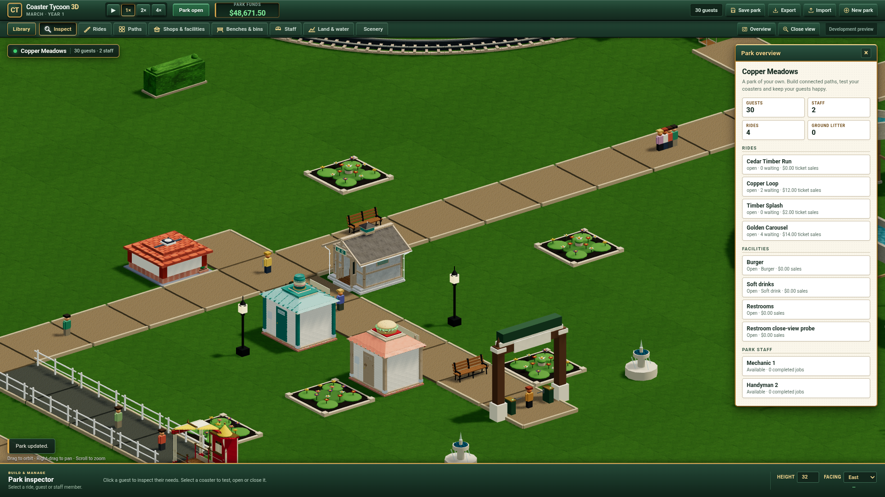

# Detailed gradual restroom validation

The independent candidate adds a detailed restroom with one payment on entry,
gradual relief and a safe public exit. Closed or repriced facilities keep their
admitted guests. Occupied demolition requires a legal exit before releasing
guests, retiring revenue and freeing the facility slot. Save15/content8/Worker8
retain genuine historical14 parks through the receiving Rules extension.

This is the current dirty delivery on base `754f90a`. Public production still
uses the accepted information47 release. [Progress](../../PROGRESS.md) records
the active owners, full receipts, preservation and remaining release work.

## Executed checks

All compilation, tests, simulation, Blender and browser execution ran on Grok
Bot. The Mac performed edits, transport, file IO and streaming hash comparisons.

| Boundary | Actual result |
| --- | --- |
| Kernel | Original canonical run: 409 passing cases and one failing old-v6 scenery recipe. Corrected projection and affected restroom/scenery supplement: 15/15 passed. Original failure preserved. |
| Active-use liveness | Independent genuine paid admission confirms legal growth4/5 at need period1 can remain using through tick262146. A new regression fails before repair at the required completed phase. Only active-use passive bladder growth is suppressed; 45/45 affected restroom, people, recovery and service cases then pass. Exit waiting still grows, other needs continue, accounts charge once and strict/full-split saves agree. Original diagnosis and red remain retained. |
| Paid ownership | Additional autonomous guest completes three actual rides, buys unfinished food, Map and Umbrella, then pays for a partial restroom visit. Closure, max repricing, paused strict restore and safe demolition preserve those items and accounts. Focused new case passed; 39 unchanged merchandise cases were skipped and their previous evidence reused. |
| Genuine Node14 continuation | 30 complete checkpoints, three legal recipes, ten full/split comparisons and six strict historical14 negatives passed. Root independently consumed the full retained result. |
| Genuine Chrome14 continuation | 36 complete checkpoints and native15 reimports, five whole legal recipes and six full/split comparisons against original endpoints passed. Root independently consumed complete authorities, views, inspections, Rules and actual source responses. |
| Real GLB | 3,826 triangles, eight primitives/materials, finite attributes, nondegenerate indices and real embedded-image decoding passed. All 23 original art files and source material pins match the retained copy. |
| Loader | Remote frontend build and 14 real GLTFLoader boundary/resource checks passed, including malformed geometry/anchors/attributes/budgets and owned disposal. |
| Actual native UI | 33 completed checks include Library choice, native placement/picking, actual four-direction anchors and instanced bounds, paid visit import, close/reprice, blocked exit, safe partial demolition, slot reuse, save15/old14 preservation, actual transaction abort, new autosave, export and missing-model rejection. The 27 canonical browser checks also passed within this run. |
| Native source binding | Root read-only consumer confirms 41 actual original responses for all eight required changed modules/GLB and 558 other available responses match the frozen source bytes. No uncaught runtime exceptions. |
| Browser ownership | Both the main native run and supplemental close-view capture naturally close Chrome with exit0, restore the complete origin IndexedDB schemas/keys/values and local/session storage, leave ports closed and preserve the frozen stage. |

The native witness is generated by the actual Chrome Engine through public
commands and advances with the exact receiving Rules. Its clock-free generation
and subsequent native shipping Worker receiving/operations are separate scopes.
No guest history, saved ownership or receiving Rules were fabricated.

## Preserved failures and scope

The original current15/Chrome14 experiment exits1 because its private collector
overwrites the recipe category with the Worker kind and counts zero recipes.
All five actual recipe receipts remain complete. A separate read-only consumer
and Root consumption validate them; the original FAIL report is unchanged.

The original native driver exits1 at its final compound response-body assertion.
For 84 PNG Fetch responses Chrome returns an empty CDP body despite completed
nonzero HTTP200 transfers. Sixty Image PNG responses provide exact bytes. The
required scripts and real restroom GLB provide their exact original bytes.
Root separately validates those source pins and completed native observations;
the compound assertion remains failed. The 84 unavailable PNG bodies are never
reconstructed or reported as byte-qualified.

The complete original Chrome migration mirror contains 352 files/262,538,503
bytes; the complete original native mirror contains 241 files/309,166,870 bytes.
Root checks every retained path, byte count and SHA against sealed remote pins.
Failed transports, original art failures and packed editable masters are retained.

Actual game screenshots show the inspector's paid/closed/using/waiting states.
The original entry-adjacent placement is occluded by the entrance arch. A separate
paused, legal placement at tile20,14 supplies front, opposite-front and rear
close views without repeating the gameplay suite. Independent pixel review
remains separate from functional evidence.

This unchanged supplemental game PNG is 2,436,765 bytes, SHA256
`5e3ed1bae5767debf8fdd81fc750f895973cc99e051b9cf8ce050193401116aa`.
Root and independent Luna reviewed all three close views. The entrance/WC plaque
are visible and no new material defect was observed; overview wayfinding remains
unqualified. These are actual SwiftShader pixels, without a GPU/style verdict.

The fee0 and four-unit relief per tick are uncalibrated independent candidates.
During active use bladder relief progresses without passive growth cancelling it;
after completion ordinary pressure growth resumes while waiting for a legal exit.
The repaired82-file compiler is `4bbcf5f8003c448f7d7db7d5fb42072b1802a0f438e9df1a0261fe84c6b5cf21`.
Only simulation/people.js differs from the qualified pre-fix compiler; the new
182-file frozen runtime is `014a6ae23ba4cba50f56c637c8881a4cd64719cdd1f0e29a65f9a627478f7906`.
Actual repaired browser/public qualification remains pending.
Original numerical/art agreement, human style/play, representative GPU,
original-scale performance and public qualification remain open. Two complete
cumulative Design and Drift review rounds are required before finite83 closure.
