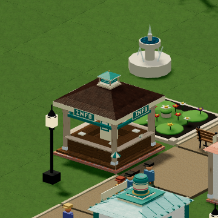
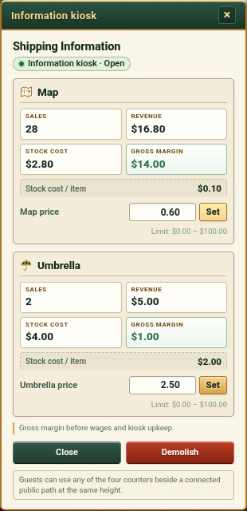
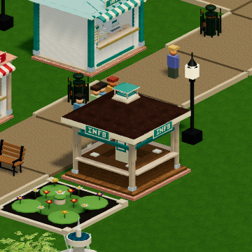
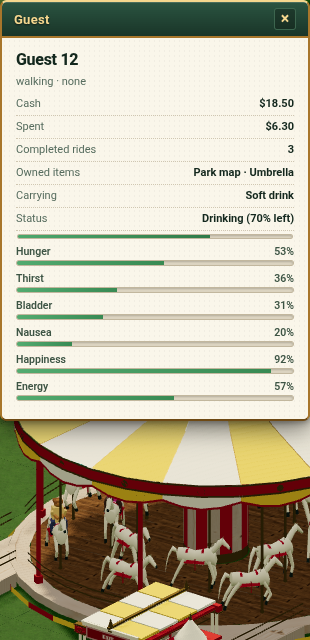

# Information kiosk and permanent merchandise

Implemented finite candidate: save14/content7/protocol7, independent MIT code and
R7 authored model. [Public functionality and source qualification](public-publication.md)
pass at both the current and immutable information routes; full WD retention
is verified. Both cumulative Design/Drift rounds and final material supplements
are complete and scoped PASS.
The full first-playable Goal,
original numerical/art fidelity, complete catalogue, human style and representative
integrated GPU/scale remain open.

A player selects Information kiosk in the Classic Library, places it beside a
connected public path at the same height, opens it and prices Map/Umbrella
independently. Each visit makes at most one sale. Permanent ownership coexists
with held consumables and survives closure, demolition and save continuation.

[Core and lifecycle](core-and-lifecycle-disposition.md) accepts402 canonical cases
across37 files by composition, genuine old13 continuation and actual autonomous
Map/Umbrella purchases with complete finance/retirement conservation. Original
failed commands and targeted supplements remain distinct.

[Receiving and persistence](native-phase-audit.md) accepts actual qualified asset
loading/picking/disposal, unavailable-model interception, real timer/import/abort/
reload and complete snapshot-plus-IndexedDB FIFO. It narrows earlier overclaims.

[Current UI and browser](current-ui-and-browser-disposition.md) accepts11 native
player actions,27 complete canonical browser checks and Root/fresh Luna actual
game pixel inspection. Native current-r3 remains failed from its later harness
timeout; the complete supplemental regression passes on identical source.

[Maximum input](maximum-input-disposition.md) observes a legal64MiB native import,
unchanged Worker input, exact state and a retained native Export. Its measured
6.6-second import includes a2.9-second sampling gap on Grok/SwiftShader; smooth
responsiveness and representative hardware remain unqualified.

[Cumulative reviews](cumulative-review-disposition.md) separates whole Design/Drift
rounds from earlier phase reviews. Second-round final public/retention supplements are complete and scoped PASS;
first-round final material supplements are also complete and scoped PASS. All builds, tests, simulation, Chrome and large scientific
reading run on Grok Bot. Full raw evidence and editable masters remain on WD;
the images below are copies of actual retained game captures.

